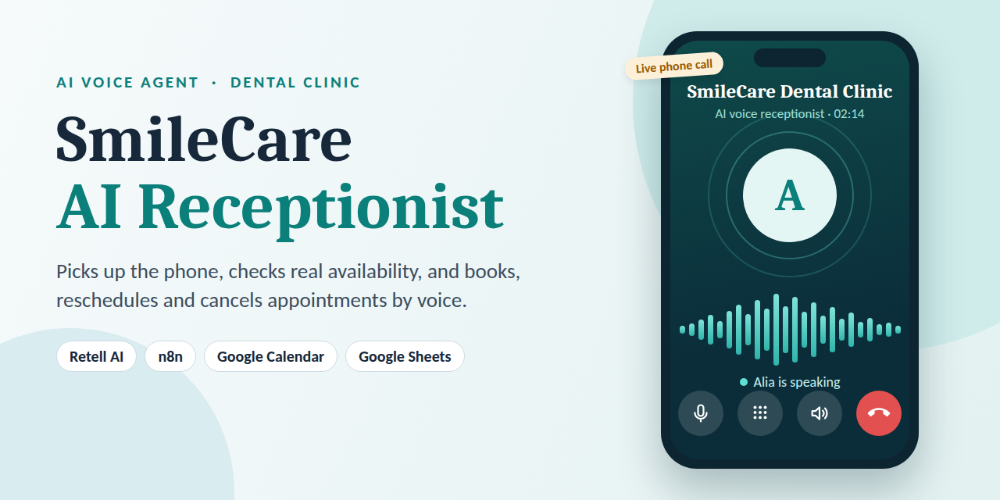
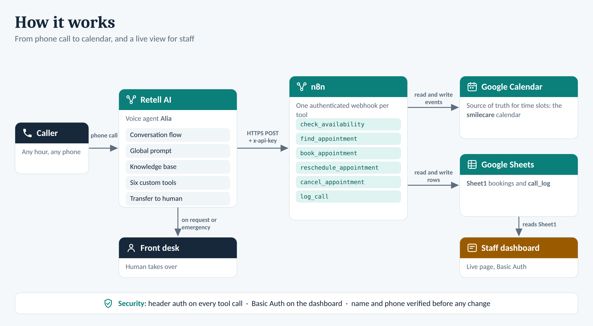
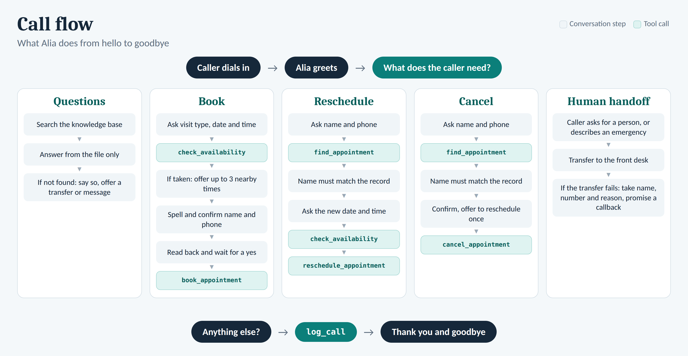

<div align="center">



# SmileCare AI Receptionist

**A voice agent that answers the clinic phone, checks real availability, and books, reschedules and cancels appointments.**

Retell AI · n8n · Google Calendar · Google Sheets

</div>

---

## Demo

[](YOUR_DEMO_VIDEO_URL)

> Replace `YOUR_DEMO_VIDEO_URL` with your YouTube / Loom / Drive link. See [`demo/README.md`](demo/README.md).

## What it does

Alia, the AI receptionist for the fictional **SmileCare Dental Clinic**, can:

- Answer clinic questions (location, hours, pricing, insurance) from a knowledge base, and never guess outside it
- Check Google Calendar for a free slot and offer up to three nearby alternatives when one is taken
- Book new appointments after spelling back and confirming the caller's name and phone number
- Find, reschedule and cancel existing appointments, verifying name and phone before any change
- Hand over to a human on request or in an emergency
- Log every call (caller, phone, summary, appointment status) to a sheet

## How it works



Retell AI runs the conversation. Each tool call is an authenticated HTTPS `POST` to an n8n webhook, which reads and writes Google Calendar (the source of truth for time slots) and Google Sheets (bookings and call log). A staff dashboard can read the bookings sheet.



## Repository layout

```
smilecare-ai-receptionist/
├── README.md
├── LICENSE
├── .env.example               # every placeholder you need to fill in
├── .gitignore
├── assets/                    # diagrams, screenshots, social preview
├── docs/
│   ├── SETUP.md               # step-by-step setup
│   ├── API.md                 # webhook contracts (one per tool)
│   └── GOOGLE_SHEETS_SCHEMA.md
├── n8n-workflows/             # import these into n8n
│   ├── check_availability.json
│   ├── book_appointment.json
│   ├── find_appointment.json
│   ├── reschedule_appointment.json
│   ├── cancel_appointment.json
│   └── log_call.json
├── retell/
│   └── smilecare_agent.json   # agent + conversation flow + tool definitions
├── knowledge-base/
│   └── SmileCare_Knowledge.md # upload to the Retell agent
└── demo/
    ├── README.md
    └── demo-placeholder.mp4   # replace with the real demo
```

## Quick start

1. Create a Google Calendar and a Google Sheet ([schema](docs/GOOGLE_SHEETS_SCHEMA.md)).
2. Import the six workflows from `n8n-workflows/` into n8n and connect your credentials.
3. Create the Retell agent from `retell/smilecare_agent.json`, point each tool at its n8n webhook, and upload the knowledge base.
4. Call the agent and test.

Full instructions: **[docs/SETUP.md](docs/SETUP.md)**

## Configuration

All secrets and IDs in this repo are placeholders. Nothing here will work until you replace them with your own values. The list is in [`.env.example`](.env.example).

| Placeholder | Where it appears |
|---|---|
| `YOUR_WEBHOOK_API_KEY` | Retell tool headers + the n8n Header Auth credential |
| `https://n8n.your-domain.com/webhook/YOUR_WEBHOOK_PATH_HERE` | Retell tool URLs |
| `YOUR_GOOGLE_CALENDAR_ID@group.calendar.google.com` | Calendar nodes in n8n |
| `YOUR_GOOGLE_SHEET_ID`, `YOUR_CALL_LOG_SHEET_GID` | Sheets nodes in n8n |
| `+920000000000` | Human-transfer number in the Retell agent |

## Security notes

- Every webhook requires an `x-api-key` header (n8n Header Auth).
- Name and phone number are verified before any reschedule or cancellation.
- Do not commit real credentials, call transcripts or patient data. n8n exports can embed test-run data (`pinData`), so clear it before exporting.

## Tech stack

Retell AI (voice agent) · n8n (workflow automation) · Google Calendar API · Google Sheets API · JavaScript (availability logic)

## License

MIT, see [LICENSE](LICENSE). SmileCare Dental Clinic is a fictional clinic; all names, prices and numbers are sample data.
