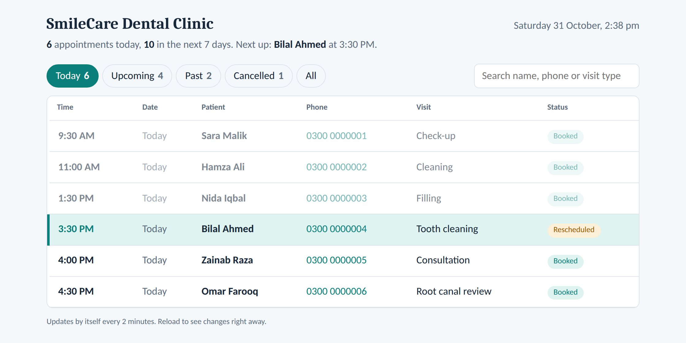

# SmileCare AI Receptionist

**An enterprise-grade AI voice agent that answers clinic calls, checks real-time availability, and manages 30-minute appointment bookings, rescheduling, and cancellations.**

Retell AI · n8n · Google Calendar · Google Sheets

---

## Demo

---

## What it does

Alia, the AI receptionist for **SmileCare Dental Clinic**, handles end-to-end voice operations:

- **Knowledge Base Q&A:** Answers clinic queries (location, hours, pricing, insurance) directly from the clinic knowledge base without halluncinating or guessing.
- **Real-Time Calendar Sync:** Checks Google Calendar for availability and suggests up to three 30-minute alternative slots when a requested slot is taken.
- **Smart Booking & Verification:** Verifies patient details by spelling names back and confirming contact numbers before booking.
- **Record Retrieval & Rescheduling:** Enforces phone number verification to locate existing patient records before performing rescheduling or cancellations.
- **Emergency Triage & Human Transfer:** Instantly detects urgent medical symptoms (severe pain, facial swelling, trauma) to direct callers to 1122 or transfer them to human clinic staff.
- **Real-Time Call Logging:** Automatically logs every call summary, patient info, and booking status directly to Google Sheets.

---

## Staff Dashboard

Clinic staff can view live appointment updates, daily summaries, and patient statuses at a glance through the automated dashboard:

* **Daily Overview:** Highlights current day bookings, upcoming week schedule, and urgent priority appointments.
* **Instant Filtering:** Filter appointments by `Today`, `Upcoming`, `Past`, `Cancelled`, or search by patient name/phone number.
* **Auto-Sync:** Reads real-time booking logs directly from the Google Sheets backend.

---

## How it works

Retell AI processes conversational voice audio in low latency. Each tool call executes an authenticated HTTPS `POST` request to an n8n webhook, which manages state across Google Calendar (the source of truth for 30-minute slots) and Google Sheets (bookings and call logging).

---

## Environment & Configuration

| Placeholder | Where it appears |
|---|---|
| `YOUR_WEBHOOK_API_KEY` | Retell tool headers + n8n Header Auth credential |
| `https://n8n.your-domain.com/webhook/YOUR_WEBHOOK_PATH_HERE` | Retell tool URLs |
| `YOUR_GOOGLE_CALENDAR_ID@group.calendar.google.com` | Calendar nodes in n8n |
| `YOUR_GOOGLE_SHEET_ID`, `YOUR_CALL_LOG_SHEET_GID` | Sheets nodes in n8n |
| `+920000000000` | Human-transfer phone number in Retell agent setup |
